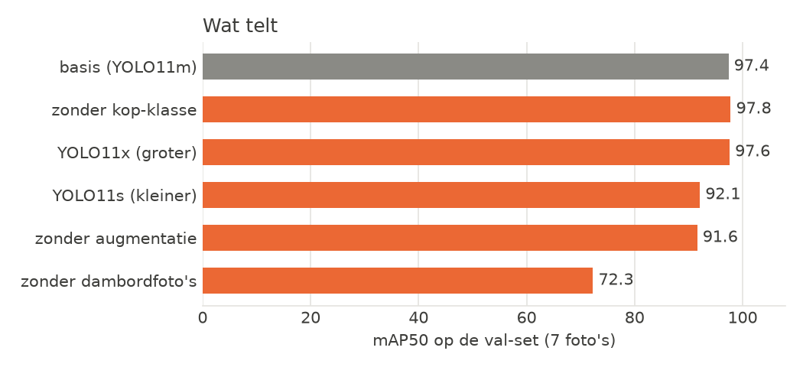
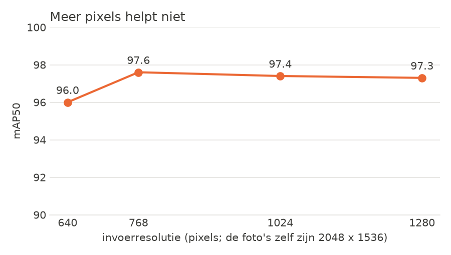
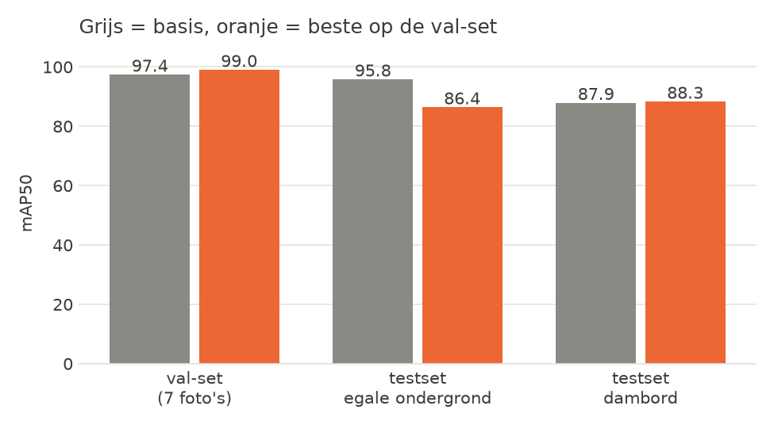

# Experimenten

Ik heb YOLO11-OBB gekozen omdat het simpel is: het geeft direct geroteerde boxen, traint snel (4 à 5 minuten per
model) en werkt stabiel. Hieronder wat ik heb geprobeerd en wat eruit kwam.

## Data en labels

- 19 foto's op een egale ondergrond en 56 foto's op een dambord, in 6 opstellingen. Steeds dezelfde onderdelen uit de zak.
- De foto's op de egale ondergrond heb ik gelabeld in CVAT met geroteerde boxen. Bij bouten en koppelingen zet ik ook een punt `kop` bij
  de kop. Een script zet dat om naar het uiteinde van de box, zodat de hoek van de kop naar de punt wijst.
- De dambordlabels zijn voorgelabeld met een al getraind model.
- `data/split.yaml`: train 11 egaal + 20 dambord (opstellingen A-B), val 2 egaal + 5 dambord (opstelling C), test 6 egaal
  + 31 dambord (opstellingen D, donker en E). Train, val en test delen nooit een dambord-opstelling.

## Kop als klasse

Een geroteerde box zegt niet aan welke kant de kop zit: een bout op 30 graden is dezelfde box als op 210 graden. Daarom
krijgt YOLO een 9e klasse `kop`, een kleine box op de kop. Na het voorspellen kijk ik per bout welk uiteinde het dichtst
bij een gevonden kop ligt. Dat is de kop. Dit kost geen extra model en, zo bleek, ook geen score.

## Maten

Sommige klassen hebben 2 maten: kleine en grote ringen, korte en lange bouten. YOLO kent alleen de klasse, dus de maat
haal ik uit de lengte van de box, zonder opnieuw te trainen. Pixels zeggen niks, want de camera hangt niet steeds even
hoog (een moer is 94 tot 190 pixels). Daarom deel ik de lengte door die van de moer op dezelfde foto: de moeren zijn
allemaal even groot.

`sizes.py` verdeelt per klasse de lengtes in 2 groepen, met zo min mogelijk spreiding per groep (zoals Otsu). Dat doe ik
op de train- en val-foto's van de egale ondergrond, omdat daar staat welke onderdelen niet helemaal zichtbaar zijn.
Dezelfde maat schommelt tot 1.25 keer door perspectief, dus pas vanaf 1.4 keer verschil tel ik het als 2 maten.

| Klasse | Groep 1 | Groep 2 | Verschil | Uitkomst |
|---|---|---|---|---|
| zeskantbout | 1.65 | 3.89 | 2.35x | kort en lang |
| slotbout | 3.38 | 6.55 | 1.94x | kort en lang |
| insteekkoppeling | 0.87 | 1.31 | 1.52x | klein en groot |
| ring | 1.09 | 1.55 | 1.43x | klein en groot |
| inbusbout | 1.97 | 2.45 | 1.24x | 1 maat |
| koppelbus | 1.54 | 1.85 | 1.20x | 1 maat |
| knopschroef | 1.66 | 1.86 | 1.12x | 1 maat |

(Groep 1 en 2: de lengte als deel van de moer.)

## Resultaat

Het model in `models/yolo11m_obb.pt` (YOLO11m, 1024 px), op de testset. Gemiddeld over 3 keer trainen:

| | mAP50 | F1 | Kop goed | Hoekfout |
|---|---|---|---|---|
| Egale ondergrond | 94.6 ± 1.5 | 95.7 | 96% | 2.5 graden |
| Dambord, nieuwe opstellingen | 86.8 ± 0.7 | 89.2 | 95% | 2.3 graden |

Het model in `models/` is 1 van die 3 keer: 96.3 op de egale ondergrond en 86.1 op het dambord. Toen opstelling C nog in train
zat (5 foto's meer om van te leren) haalde de basis 95.8 en 87.9, ongeveer 1 punt boven het gemiddelde.

Krijgt een gevonden onderdeel dezelfde maat als het label? Met het model in `models/`:

| Klasse | Egale ondergrond | Dambord |
|---|---|---|
| ring | 22 van 22 | 181 van 210 (86%) |
| zeskantbout | 20 van 20 | 110 van 113 (97%) |
| slotbout | 6 van 6 | 20 van 22 (91%) |
| insteekkoppeling | 19 van 19 | 144 van 147 (98%) |
| samen | 67 van 67 | 455 van 492 (92%) |

De ring is het lastigst: kleine en grote ringen schelen maar 1.43 keer, dus een iets te grote of te kleine box zet hem
al aan de verkeerde kant van de grens. Er moet ook een moer op de foto liggen. En dit meet of voorspelling en label het
eens zijn, niet of de maat echt klopt: nergens is gelabeld welke maat een onderdeel heeft.

## Hoe ik gekozen heb

Alle keuzes heb ik gemaakt op de val-set (7 foto's). De testset heb ik pas aan het eind 1 keer gebruikt. Kiezen op de testset maakt het eindresultaat mooier dan het is.

Eerst heb ik hetzelfde model 3 keer getraind: 96.5, 97.4 en 98.4 mAP50. Een verschil kleiner dan ongeveer 2 punten zegt
dus niks.

## Wat telt

Steeds 1 ding anders dan de basis (YOLO11m, 1024 px, 200 epochs, met augmentatie en dambordfoto's):

- Foto's van de nieuwe scène in de training zijn het belangrijkst: zonder dambordfoto's -25.
- Augmentatie (draaien, spiegelen, schalen, helderheid) is nodig: zonder -6.
- YOLO11m is de goede maat. Kleiner is slechter, groter levert niks op en is 2 keer zo traag.
- De kop-klasse kost niks.
- Verder geprobeerd, allemaal binnen de ruis: meer epochs, mosaic, mixup 0.2, perspective en een cosine learning rate.
  SGD (87.0) en een lagere learning rate (93.8) waren slechter.

## Meer pixels helpt niet

Dit vond ik het verrassendst. De onderdelen zijn soms klein en de foto's zijn 1536 x 2048, dus ik verwachtte dat een
hogere resolutie zou helpen. Dat deed het niet: 768 px is even goed als 1024 en 1280, en traint 1.6 keer zo snel. Bij
640 is het iets lager (96.0), net binnen de ruis.

## De valkuil

Op de val-set leek "mixup 0.2 en voorspellen op 1536 px" het beste: 99.0 tegen 97.4. Op de testset was het op de egale
ondergrond juist veel slechter. (Voor deze testmeting zat opstelling C nog in train, daarom staat de basis hier op 95.8.)

Lange bouten kregen bij voorspellen op 1536 px een te korte box. Op de val-set was dat niet te zien, want daar zaten de
2 egale foto's al op 100. Les: 7 foto's zijn te weinig om verschillen van 1 of 2 punten te zien. Daarom blijven de
standaardinstellingen.

## Wat ik nog zou doen

- Een grotere val-set, met donkere en egale foto's, of kruisvalidatie (folds), zodat kleine verschillen wel te zien zijn.
- Meer foto's op de egale ondergrond: met meer trainfoto's steeg de score nog.
- Foto's van andere onderdelen. Nu zijn het steeds dezelfde 29, dus de scores zeggen niks over nieuwe onderdelen.
